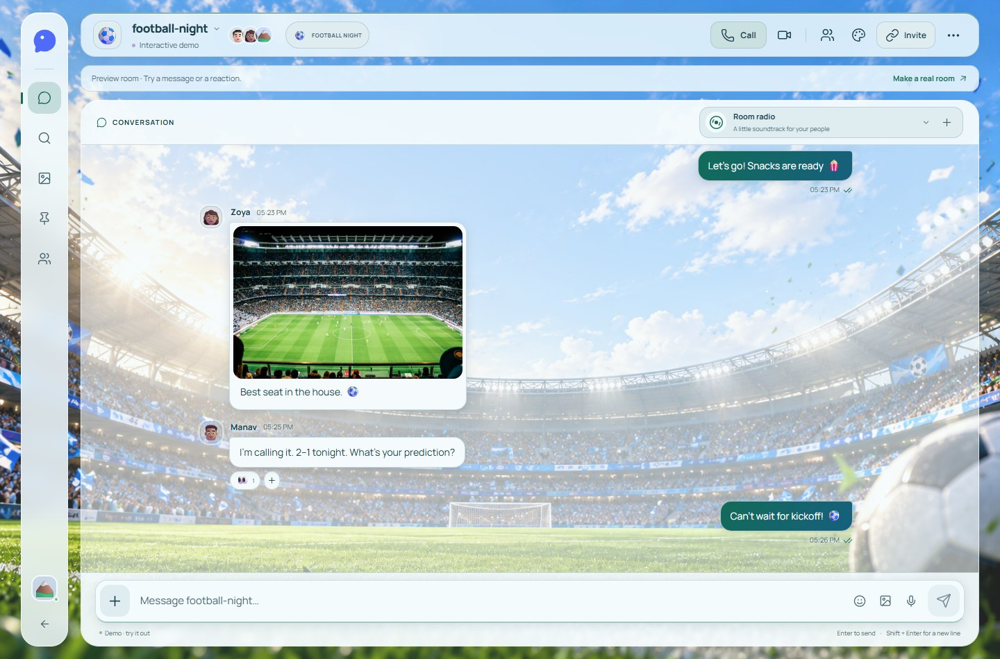
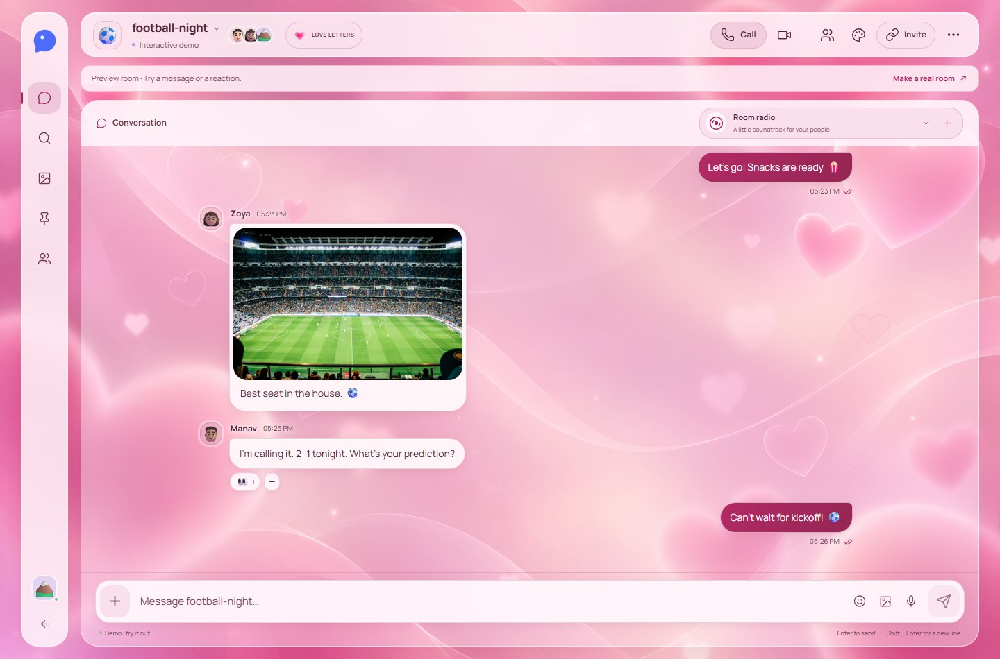
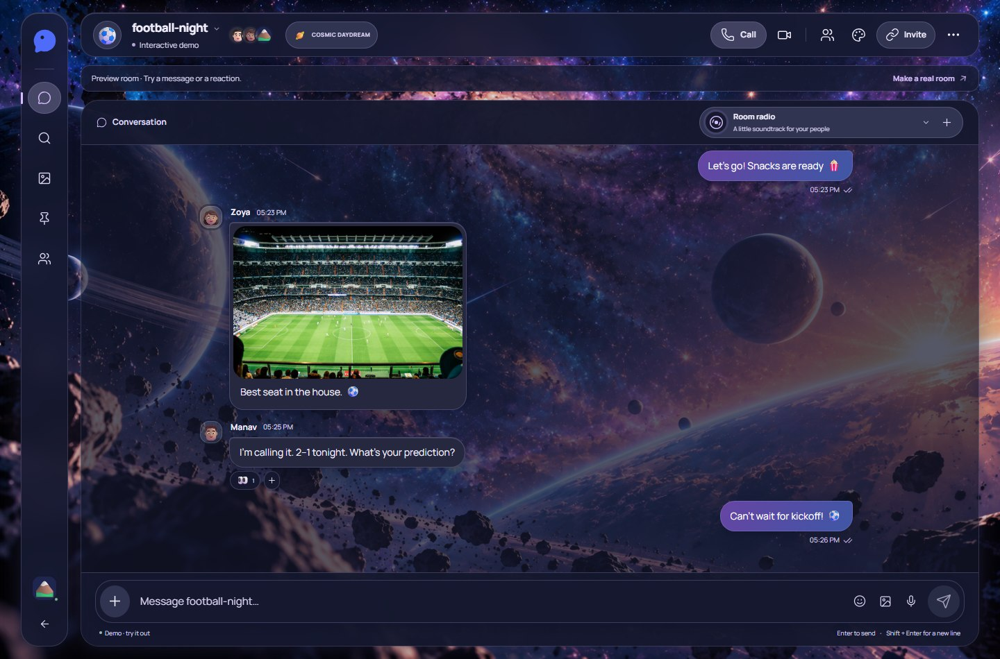
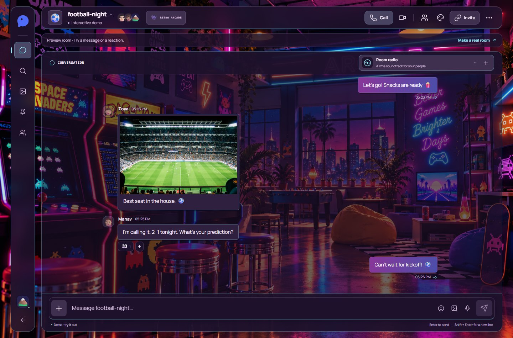
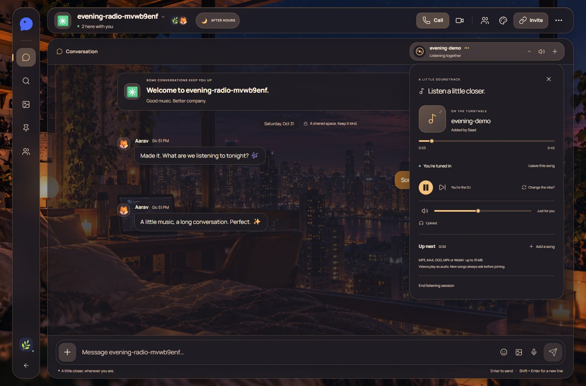
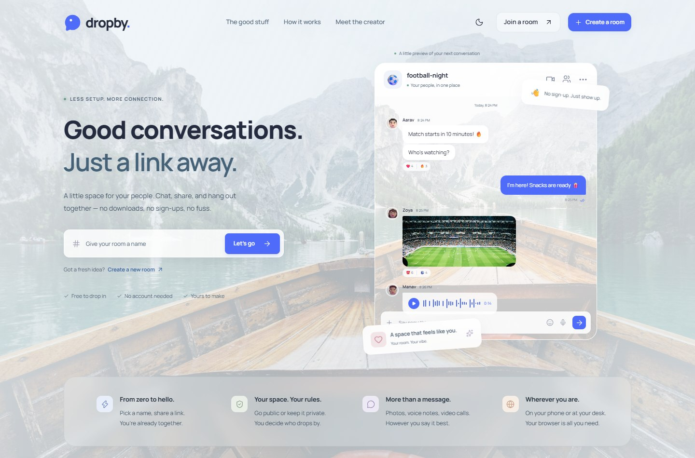
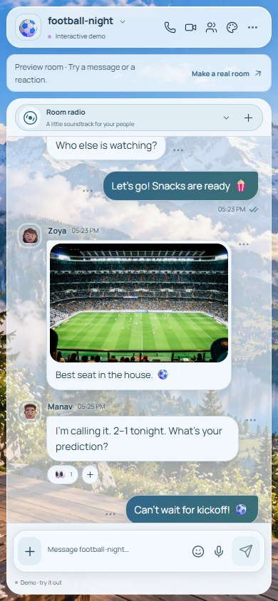
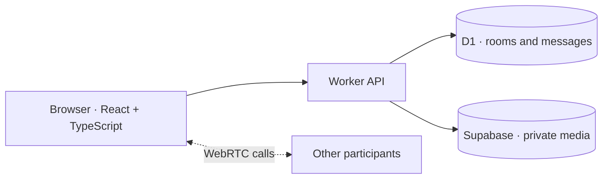

<div align="center">

<picture>
  <source media="(prefers-color-scheme: dark)" srcset="docs/assets/dropby-logo-dark.svg">
  <source media="(prefers-color-scheme: light)" srcset="docs/assets/dropby-logo-light.svg">
  
</picture>

### Good conversations. Just a link away.

**A little space for your people. Chat, call, share, and listen together.**

Pick a room name. Share the link. Make yourself at home.<br>
No downloads. No mandatory sign-up. Just your browser.

<p>
  
  
  
  
</p>

**10 room themes · shared music · expressive emojis · voice & video calls**

[Explore](#a-room-that-feels-like-yours) · [Screenshots](#a-different-mood-for-every-conversation) · [Run locally](#run-it-locally) · [Read the code](CODE_GUIDE.md) · [Meet the creator](#made-by-mohammad-saad)

</div>

<br>



<p align="center"><sub>One link. Your people. A room that feels like yours.</sub></p>

## A room that feels like yours

DropBy brings the small things that make a conversation feel natural into one place: a quick voice note, a photo worth sharing, a song everyone can listen to, and a space that matches the mood.

| | What you can do |
| :--- | :--- |
| **Drop in, stay a while** | Create public or password-protected rooms. Choose a name, avatar, and room logo, then invite people with a link. Guest identities work without an account. |
| **Say it your way** | Send messages, photos, videos, files, and voice notes. Reply, react, edit, pin, and search loaded conversations. Sent emojis come to life with short animations. |
| **Listen together** | Add audio or video files to Room radio. Share a queue and synchronized playback while each person chooses to listen, pass, or mute. Videos play as audio. |
| **Get a little closer** | Start browser voice/video calls, switch devices, or share your screen. Built-in peer calls support up to four people; optional LiveKit configuration supports larger groups. |
| **Set the atmosphere** | Switch between ten themes with coordinated wallpapers, colors, surfaces, and motion. Choose light/dark mode, personalize the wallpaper, or share the room's theme. |
| **Keep your space yours** | Owners can manage members, lock joins, and review reports. Every member can delete all their own messages and chat attachments from a room for everyone. |

## Share more, load less

Photos are optimized gently and previewed with thumbnails. GIFs keep their animation; videos and voice notes load when played. Larger uploads support progress, pause/resume, retry, cancellation and recovery after refreshing. Images have an 8 MB cap, videos 30 MB, voice notes 10 MB, documents 15 MB, profile photos 3 MB and wallpapers 8 MB.

Private file access is checked by the Worker. An explicitly configured administrator can review estimated storage, 70/85/95% warnings and abandoned-upload cleanup. Text chat continues when the media budget is full. [Configuration, privacy and cleanup policy →](docs/SMART_MEDIA.md)

## A different mood for every conversation

Themes shape the whole room: message bubbles, panels, controls, colors, and atmosphere.

<table>
  <tr>
    <td width="50%"><br><strong>Love letters</strong><br><sub>Soft rose, floating hearts, and a little warmth.</sub></td>
    <td width="50%"><br><strong>Cosmic daydream</strong><br><sub>A quiet conversation somewhere among the stars.</sub></td>
  </tr>
  <tr>
    <td width="50%"><br><strong>Retro arcade</strong><br><sub>Neon nights and one more round.</sub></td>
    <td width="50%"><br><strong>Football night</strong><br><sub>The match is always better together.</sub></td>
  </tr>
</table>

Also included: **Alpine escape, Lavender haze, Ocean blue, Golden hour, Into the green, and After hours.** Every theme supports light and dark mode; Love, Football, Arcade, and Cosmic have separate day/night artwork. Reduced motion is supported throughout.

## A little soundtrack for your people

Room radio keeps shared listening close to the conversation. Upload an MP3, M4A, OGG, MP4, or WebM file, build a queue, and let everyone decide whether to join in.

- **Your choice:** listen or pass for each song, with personal volume and mute.
- **Shared controls:** the DJ or a room moderator can pause, seek, skip, or end the session.
- **Room for everyone:** anyone can add a song or ask for a change; the queue holds up to 20 tracks.
- **Stay in sync:** immediate local seeking, ordered playback updates, and drift correction keep listeners aligned.



<sub>Shared playback is synchronized, rather than sample-accurate. Each listener opts in before audio plays. Video uploads use audio-only playback; the server does not convert them into MP3 files.</sub>

## From the first hello to your next conversation

<picture>
  <source media="(prefers-color-scheme: dark)" srcset="docs/assets/home-dark.jpg">
  <source media="(prefers-color-scheme: light)" srcset="docs/assets/home.jpg">
  
</picture>

<details>
<summary><strong>Take a look on mobile</strong></summary>
<br>
<p align="center"></p>
</details>

<sub>Screenshots are captured from the running local application. Theme previews use the labeled interactive demo; the radio screenshot uses two local test identities and a generated audio fixture.</sub>

## Run it locally

You'll need **Node.js 22.13+**, npm, and a current browser.

```bash
git clone https://github.com/saad4228/dropby-webchat.git
cd dropby-webchat
npm ci
npm run build
```

Initialize a new local database by applying the seven migrations in order. For an existing database, apply only migrations it has not already received:

```bash
node --import ./scripts/sites-env.mjs ./node_modules/wrangler/bin/wrangler.js d1 execute DB --local --config dist/server/wrangler.json --persist-to .wrangler/state --file drizzle/0000_green_gargoyle.sql
node --import ./scripts/sites-env.mjs ./node_modules/wrangler/bin/wrangler.js d1 execute DB --local --config dist/server/wrangler.json --persist-to .wrangler/state --file drizzle/0001_lively_black_tarantula.sql
node --import ./scripts/sites-env.mjs ./node_modules/wrangler/bin/wrangler.js d1 execute DB --local --config dist/server/wrangler.json --persist-to .wrangler/state --file drizzle/0002_yellow_arclight.sql
node --import ./scripts/sites-env.mjs ./node_modules/wrangler/bin/wrangler.js d1 execute DB --local --config dist/server/wrangler.json --persist-to .wrangler/state --file drizzle/0003_aspiring_dagger.sql
node --import ./scripts/sites-env.mjs ./node_modules/wrangler/bin/wrangler.js d1 execute DB --local --config dist/server/wrangler.json --persist-to .wrangler/state --file drizzle/0004_lively_nicolaos.sql
node --import ./scripts/sites-env.mjs ./node_modules/wrangler/bin/wrangler.js d1 execute DB --local --config dist/server/wrangler.json --persist-to .wrangler/state --file drizzle/0005_lonely_kang.sql
node --import ./scripts/sites-env.mjs ./node_modules/wrangler/bin/wrangler.js d1 execute DB --local --config dist/server/wrangler.json --persist-to .wrangler/state --file drizzle/0006_optimal_masque.sql
npm run dev -- --port 5173
```

Open **http://localhost:5173**. Local D1 state live in the ignored `.wrangler/state` directory. Follow [smart media setup](docs/SMART_MEDIA.md#configure-the-server) to add server-only Supabase settings to `.dev.vars`. See the [development guide](docs/DEVELOPMENT.md) for hosting and optional calling settings.

## Deploy on your Cloudflare account

Use the [exact Cloudflare setup guide](docs/CLOUDFLARE_DEPLOYMENT.md). The standalone build uses the verified production D1 database and private Supabase bucket, with no R2 binding. `npm run build:cloudflare` prepares and validates the artifact; it does not deploy. Configure the encrypted Worker secret, apply verified pending migrations and configure your real administrator ID before completing the release checklist.

## Under the hood

| Layer | Built with |
| :--- | :--- |
| Interface | React 19, TypeScript, locally served Manrope and DM Sans, Lucide icons |
| App runtime | Vinext, Vite, Cloudflare Workers |
| Data | Drizzle ORM and Cloudflare D1 |
| Uploaded media | Private Supabase Storage, Worker authorization and TUS resumable uploads |
| Calls | Browser WebRTC; optional LiveKit SFU |
| Validation & checks | Zod, Node's test runner, Playwright |



Room updates use **1.5-second polling**. Room radio uses a faster lightweight playback check while a track is active, with queue/listener details refreshed separately. Messages and files persist on the server; transport is **not end-to-end encrypted**. Guest session cookies last up to 30 days, and losing a guest cookie means losing that identity's ownership unless it was linked through the optional account flow.

## Find your way through the code

Start with the [code guide](CODE_GUIDE.md). It follows a message from the composer to the database, maps each feature to its files, and explains the larger modules.

```text
app/           routes, page layouts, and theme styles
components/    homepage, onboarding, conversation, panels, and players
hooks/         appearance, calls, and voice recording
lib/           browser API, server actions, validation, and shared helpers
db/            database schema
drizzle/       tracked database migrations
tests/         unit checks, API checks, and browser journeys
public/        wallpapers, fonts, and static assets
```

[Code guide](CODE_GUIDE.md) · [Development & operations](docs/DEVELOPMENT.md) · [Implementation notes](IMPLEMENTATION.md)

## Checks that cover the important parts

The suite includes **28 unit tests, 49 existing API checks, 12 smart-media API checks, 11 isolated storage-failure checks, and 33 browser journeys**, covering conversations, permissions, uploads, room themes, calls, music playback, and deleting your own messages. The visual comparison script covers 82 desktop/mobile views.

With the local server running:

```bash
npm run typecheck
npm run test:unit
npm run test:api
npm run test:media
npm run test:e2e
npm run build
```

Browser tests default to installed Windows Chrome. Set `PLAYWRIGHT_CHROME_PATH` to your Chrome/Chromium executable on another machine. Visual baselines are local artifacts: use `npm run test:visual:record` before a change and `npm run test:visual` afterward on the same machine/browser. See [verification details and limits](docs/DEVELOPMENT.md#verification).

## Made by Mohammad Saad

> Hey, I'm Saad — a developer who enjoys turning ideas into meaningful digital experiences. I created Dropby with a simple goal: make connecting with people online feel effortless, natural and enjoyable. Always curious, always building.

[Instagram](https://www.instagram.com/saad._.4228/) · [LinkedIn](https://www.linkedin.com/in/saad4228/) · [Email](mailto:saadhussain.agr@gmail.com)

<details>
<summary>Artwork, fonts, and project scope</summary>
<br>

Theme artwork and the creator illustration were supplied by Mohammad Saad. The original lake/stadium photos are locally stored Unsplash assets. Manrope and DM Sans are served locally with their included SIL Open Font Licenses. Radio test fixtures are synthetic audio/video, rather than commercial songs. See [asset details](docs/DEVELOPMENT.md#assets).

The repository contains the application source and development history. The existing hosted review environment is access-controlled. Optional LiveKit/TURN infrastructure requires operator configuration, and a real LiveKit session has not been verified. Search covers loaded history. See [known scope limits](docs/DEVELOPMENT.md#known-scope-limits) before planning a broader deployment.

</details>

<hr>

<p align="center"><strong>A little closer, wherever you are.</strong><br><sub>Made for connection.</sub></p>
